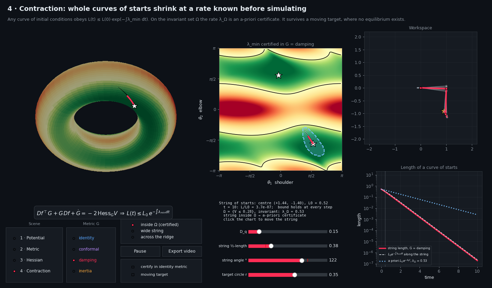
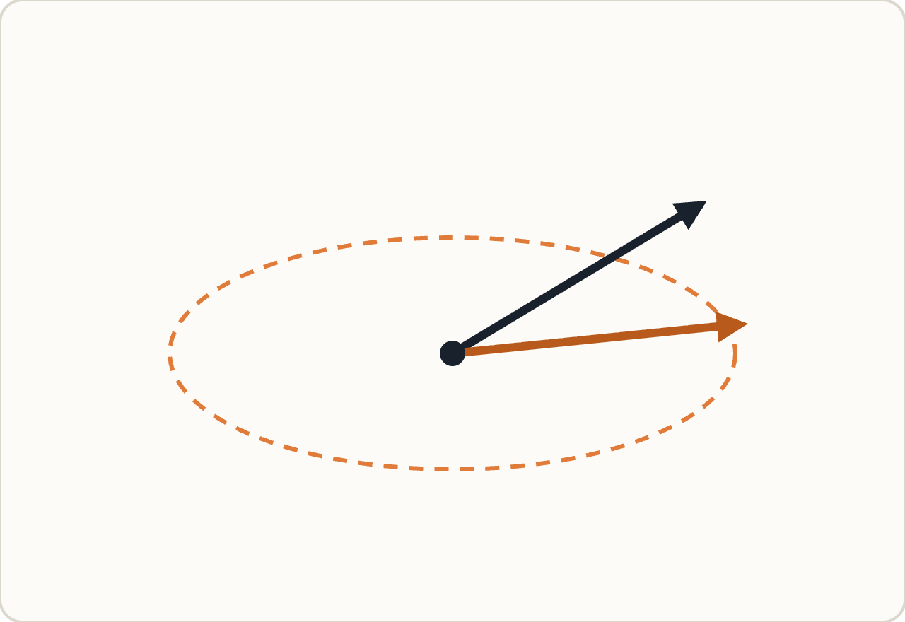
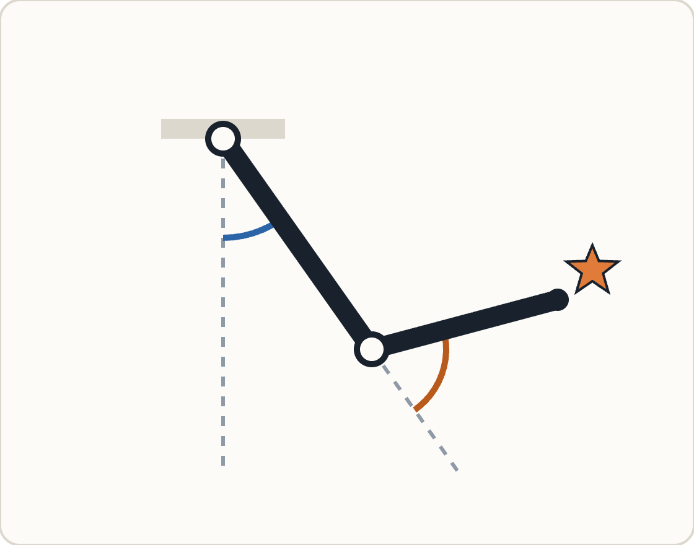
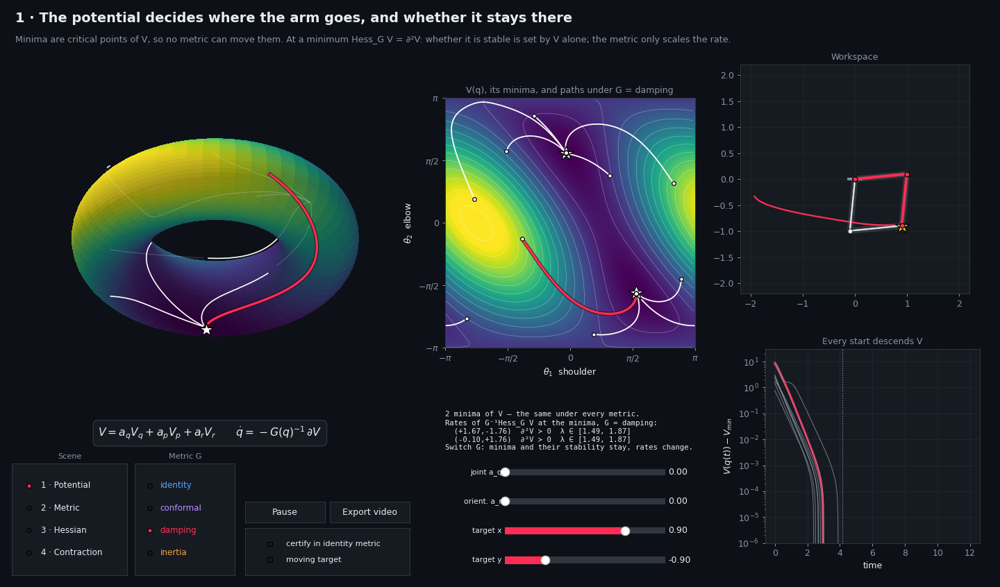
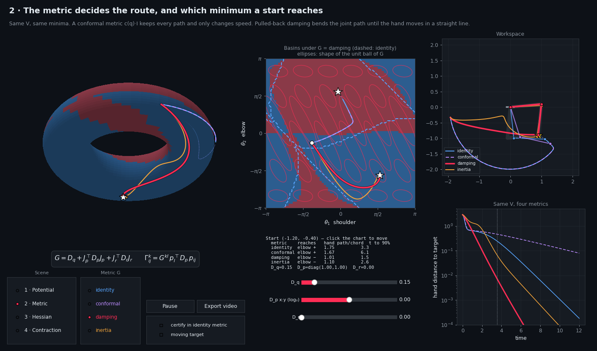
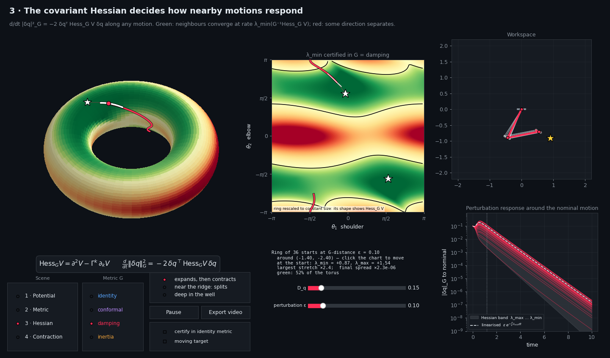
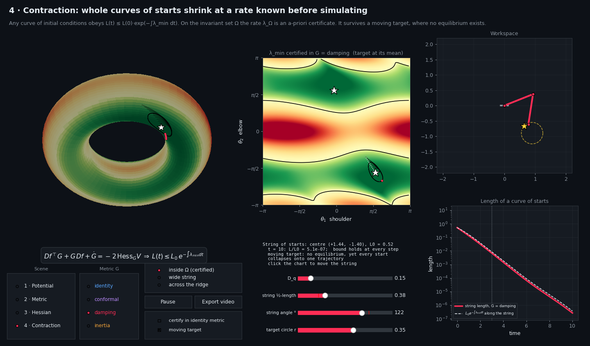

# Contraction through the lens of gradient fields

**Potential, metric, Hessian: what each one decides, shown live on a double pendulum.**



This repository is an interactive tutorial by Johannes Lachner.
It animates the first-order gradient flow of a planar two-link arm on its configuration torus and
makes one claim visible:

> For a gradient field, contraction is a property of the potential, measured in a metric.
> **V** decides where motions go. **G** decides the route. Together they set **Hess<sub>G</sub> V**,
> which decides how fast, and where, motions converge to each other.

The guide below walks through the four scenes of the app, the math behind each, and what to look
for on screen.

---

## Contents

- [Quick start](#quick-start)
- [Repository layout](#repository-layout)
- [How to read the window](#how-to-read-the-window)
- [Background: gradient fields from scratch](#background-gradient-fields-from-scratch)
- [Background: contraction for gradient fields](#background-contraction-for-gradient-fields)
- [Scene 1 · The potential V](#scene-1--the-potential-v)
- [Scene 2 · The metric G](#scene-2--the-metric-g)
- [Scene 3 · The covariant Hessian](#scene-3--the-covariant-hessian)
- [Scene 4 · Contraction](#scene-4--contraction)
- [Synthesis](#synthesis)
- [From equations to code](#from-equations-to-code)
- [Related work](#related-work)

---

## Quick start

Requires Python 3.9+ with `numpy` and `matplotlib`. `ffmpeg` is optional (MP4 export; without it
videos are written as GIF).

```bash
pip install -r requirements.txt

python interactiveGradientFlow_scenes.py                    # interactive app
python interactiveGradientFlow_scenes.py --present          # scripted 11-step walkthrough
python interactiveGradientFlow_scenes.py --present --debug  # ... with event logging in the terminal
python interactiveGradientFlow_scenes.py --snapshot DIR     # PNG of every scene into DIR
python interactiveGradientFlow_scenes.py --export-all       # MP4/GIF of every scene into exports/

python test_pendulum_gradient_model.py                      # numerical checks (also runs under pytest)
```

**Controls.** Click the flat chart to move the start (scenes 1–3) or the string (scene 4). Presets
jump to the characteristic cases. Drag the torus to rotate it. Keys `1`–`4` switch scenes, `space`
pauses, `r` restarts the animation, `f` toggles full screen.

**Presentation mode** (`--present`) precomputes all 11 steps, then steps through them with
→ ↓ PageDown `n` Enter (forward) and ← ↑ PageUp `p` (back). Each step sets the complete state, and
the speaker notes for it are printed to the terminal. The step numbers used throughout this guide
refer to this mode.

## Repository layout

| File | What it is |
|---|---|
| [`pendulum_gradient_model.py`](pendulum_gradient_model.py) | The model: kinematics, potentials, metrics, Christoffel symbols, covariant Hessian, contraction rates, RK4 integration, string integration, certified region. Analytic and vectorised, no plotting. |
| [`interactiveGradientFlow_scenes.py`](interactiveGradientFlow_scenes.py) | The Matplotlib app with the four scenes, the presentation script and the export functions. |
| [`test_pendulum_gradient_model.py`](test_pendulum_gradient_model.py) | Finite-difference checks of every derivative and of the contraction identity, plus checks of the claims made in the scenes. |
| [`docs/images/`](docs/images) | Snapshots of each scene and diagrams used below. |
| [`docs/videos/`](docs/videos) | Exported animations of each scene (damping metric). |

## How to read the window

Every scene uses the same four panels:

| Panel | Shows |
|---|---|
| **Torus** (top left) | The configuration space. One point is one arm pose, one line is one motion. Drag to rotate. |
| **Flat chart** (middle) | The same torus cut open: shoulder angle θ₁ across, elbow angle θ₂ up. The background shows the scene's quantity. Click to move the start. |
| **Workspace** (top right) | The arm itself. The yellow star is the hand target. |
| **Plot** (bottom right) | The scene's measurement over time, on a log scale. |

Below the panels: the scene's equation, the scene/metric selectors, sliders, presets, and a text block
with the numbers quoted in this guide.

---

## Background: gradient fields from scratch

### An impedance controller is the gradient of a potential

A spring on one joint and a spring on the robot's hand:

```math
V(q) = \tfrac12 k (q - q_0)^2 \;\Rightarrow\; \tau = -\partial V = -k(q - q_0),
\qquad
V_p(q) = \tfrac12 k_p \lVert h_p(q) - p_0 \rVert^2 \;\Rightarrow\; \tau = -\partial V_p = -J_p(q)^\top k_p e .
```

The elastic part of an impedance controller is a potential $`V`$, and its joint torque is the
negative gradient. Here $`h_p`$ is the forward kinematics, $`J_p = \partial h_p/\partial q`$ its
Jacobian and $`e = h_p(q) - p_0`$ the hand error. Only $`J_p^\top`$ appears: no inverse kinematics,
and the torque stays defined at singularities.

### A force is not a velocity: you need a metric



$`-\partial V`$ is a force (a covector). To command motion it has to become a velocity. That
conversion is a symmetric positive-definite metric $`G(q)`$:

```math
G(q)\,\dot q = -\partial V(q) \quad\Longleftrightarrow\quad \dot q = f(q) = -G(q)^{-1}\,\partial V(q).
```

Read it as a viscous force balance: damping force = spring force, so velocity = force ÷ damping.

*Figure:* black is the force $`-\partial V`$; orange is the velocity $`-G^{-1}\partial V`$ when vertical
motion costs 6× more than horizontal motion (dashed: the unit ball of $`G`$). With $`G = I`$ the
velocity would point along the force.

<br clear="right">

### A gradient field = a potential V plus a metric G

V and G are two separate design choices. The app runs the same V under four metrics
(`pm.METRICS`):

| Metric | $`G(q)`$ | Meaning |
|---|---|---|
| identity | $`I`$ | plain gradient descent in joint angles |
| conformal | $`c(q)\,I`$ | identity with a position-dependent speed |
| damping | $`D_q + J_p^\top D_p J_p + J_r^\top D_r J_r`$ | joint and hand dampers, pulled back to the joints |
| inertia | $`M(q)`$ | the kinetic-energy metric of the arm |

### Test system: a planar double pendulum



```math
V = a_q V_q + a_p V_p + a_r V_r,
\qquad
\begin{aligned}
V_q &= k_q \textstyle\sum_i \bigl(1 - \cos(q_i - q_{0,i})\bigr) \\
V_p &= \tfrac12 k_p \lVert h_p(q) - p_0 \rVert^2 \\
V_r &= k_r \bigl(1 - \cos(\theta_1 + \theta_2 - \varphi_0)\bigr)
\end{aligned}
```

Joint spring, hand spring and orientation spring, weighted by the sliders $`a_q, a_p, a_r`$.
$`q = (\theta_1, \theta_2)`$; θ₁ (blue) is the shoulder angle from hanging down, θ₂ (orange) the elbow
angle relative to link 1, and $`J_r = [1\;1]`$. Both angles are periodic, so the configuration space is
a **torus**. Default parameters: unit links, $`a_p = 1`$, $`k_p = 2`$, target $`p_0 = (0.9, -0.9)`$,
damping $`D_q = 0.15\,I`$, $`D_p = I`$, $`D_r = 0`$.

<br clear="right">

---

## Background: contraction for gradient fields

### Recap: contraction measures how neighbouring motions separate

For a tiny difference $`\delta q`$ between two neighbouring motions,

```math
\delta\dot q = Df(q)\,\delta q,
\qquad
\frac{d}{dt}\lVert\delta q\rVert_G^2 = \delta q^\top\bigl(Df^\top G + G\,Df + \dot G\bigr)\,\delta q ,
```

and the contraction test is

```math
Df^\top G + G\,Df + \dot G \preceq -2\lambda G
\;\Longrightarrow\;
\lVert\delta q(t)\rVert_G \le e^{-\lambda t}\,\lVert\delta q(0)\rVert_G .
```

### For a gradient field, the contraction matrix is a Hessian

```math
f = -G^{-1}\partial V
\quad\Longrightarrow\quad
Df^\top G + G\,Df + \dot G = -2\,\mathrm{Hess}_G V,
\qquad
\frac{d}{dt}\lVert\delta q\rVert_G^2 = -2\,\delta q^\top\,\mathrm{Hess}_G V\,\delta q .
```

The left side is dynamics: how the flow stretches neighbouring motions, measured in $`G`$. The right
side is geometry: how strongly $`V`$ curves upward, measured in $`G`$. **Contraction rate in G =
curvature of V in G** (geodesic convexity). This identity is checked numerically for all metrics in
`test_contraction_identity`.

### Hess<sub>G</sub> V: the curvature of V, measured with the ruler G

```math
\mathrm{Hess}_G V = \partial^2 V - \Gamma^k\,\partial_k V,
\qquad
\Gamma^k_{ij} = \tfrac12 G^{km}\bigl(\partial_j G_{mi} + \partial_i G_{mj} - \partial_m G_{ij}\bigr).
```

$`\partial^2 V`$ is the ordinary matrix of second derivatives. $`\Gamma^k\partial_k V`$ corrects for
the ruler $`G`$ changing from place to place ($`\Gamma`$ are the Christoffel symbols of $`G`$). The
correction vanishes wherever $`\partial V = 0`$ (at every equilibrium) or where $`G`$ is constant.

### Physical reading: stiffness divided by damping

```math
\mathrm{Hess}_G V\; v = \lambda\, G\, v
```

$`\mathrm{Hess}_G V`$ acts as a stiffness, $`G`$ as a damping. Along a direction $`v`$ in which the two
are proportional, a nudge relaxes on its own with rate λ = stiffness ÷ damping = 1 / time constant.
In 2D there are two such directions, the softest ($`\lambda_{\min}`$) and the stiffest
($`\lambda_{\max}`$): the eigenvalues of $`G^{-1}\mathrm{Hess}_G V`$.

| λ | a nudge in that direction |
|---|---|
| large, > 0 | snaps back fast |
| small, > 0 | lingers |
| < 0 | grows: neighbours separate |

From scene 3 on, the app colours $`\lambda_{\min}`$: **green** where $`\lambda_{\min} > 0`$ (all nudges
shrink), **red** where $`\lambda_{\min} < 0`$.

---

## Scene 1 · The potential V

*V decides where the arm goes, and whether it stays there.*



🎬 [Video: scene 1 (damping metric)](docs/videos/scene1_potential_damping.mp4)

### Equilibria and their stability come from V alone

```math
f(q^*) = 0 \iff \partial V(q^*) = 0,
\qquad
\mathrm{Hess}_G V(q^*) = \partial^2 V(q^*),
\qquad
\text{rates at } q^*: \ \mathrm{eig}\bigl(G^{-1}\partial^2 V(q^*)\bigr).
```

$`G`$ is invertible, so it drops out of the equilibrium condition, and the $`\Gamma`$ term multiplies
$`\partial V = 0`$. **V decides** where the equilibria are and whether each is a minimum, a saddle
or a maximum. **G only decides** how fast motions settle near them.

### Every motion descends V: the flow is passive

```math
G\dot q = -\partial V + \tau
\;\Rightarrow\;
\dot V = \partial V^\top\dot q = \tau^\top\dot q - \lVert\dot q\rVert_G^2,
\qquad
\tau = 0:\ \dot V = -\lVert\dot q\rVert_G^2 \le 0 .
```

The dampers only remove energy. V is a storage function, and every start slides down V until it
stops at an equilibrium; this is the bottom-right plot of scene 1. Note that this is a statement about
*one* motion. Contraction is a statement about *pairs* of motions: do they forget where they
started?

### Adding potentials adds Hessians, but not equilibria

```math
V = \textstyle\sum_i a_i V_i \;\Longrightarrow\; \mathrm{Hess}_G V = \sum_i a_i\,\mathrm{Hess}_G V_i
```

This holds because all modules share one $`G`$, hence one $`\Gamma`$. Hessians add, so a certificate
can be assembled module by module; a module may be indefinite on its own as long as the sum is
positive. Equilibria do not add: the minima of the sum are not the minima of the parts.

### What to do in the app

| Step | Setting | What you should see |
|---|---|---|
| 1 | G = damping | Two white stars: elbow up and elbow down, both put the hand on the target. Nine starts each end in one of them. λ ∈ [1.49, 1.87] at both minima. |
| 2 | G = identity | Same stars, same stability. The paths change, the minima do not move. λ ∈ [0.89, 4.35]: the metric only scales the rates. |
| 3 | slider `joint a_q` = 0.5 | A joint spring is added. The elbow-down minimum disappears, every start goes to the remaining one, λ ∈ [1.22, 1.65]. |

Also try moving the target (`target x`, `target y`) or adding the orientation spring (`orient. a_r`).

---

## Scene 2 · The metric G

*G decides the route, and which minimum a start reaches.*



🎬 [Video: scene 2 (damping metric)](docs/videos/scene2_metric_damping.mp4)

The flat chart shows the **basins** of the two minima under the selected metric (dashed blue: the
basin boundary under the identity), with ellipses showing the shape of the unit ball of $`G`$. All
four metrics are integrated from the same start and drawn together.

### Scaling the metric changes the speed, not the path

```math
G = c(q)\,I \;\Rightarrow\; \dot q = -c(q)^{-1}\partial V;
\qquad
ds = dt / c(q) \;\Rightarrow\; \frac{dq}{ds} = -\partial V .
```

With the new clock $`s`$ this is exactly the flow of $`G = I`$: the same paths, traversed at a
different speed. In the app the purple dashed path (conformal) lies exactly on the blue one (identity),
only later. **Only the direction-dependent part of G bends paths.** (Checked in
`test_conformal_metric_keeps_paths`.)

### The metric moves basin boundaries, not minima

In 2D the boundary between two basins runs through a saddle $`q_s`$ of $`V`$. Close to $`q_s`$ the flow
is linear, $`\delta\dot q = -G(q_s)^{-1}\partial^2V(q_s)\,\delta q`$, and the boundary leaves $`q_s`$
along the eigenvector of $`G(q_s)^{-1}\partial^2V(q_s)`$ with positive eigenvalue. The saddle point
is fixed by V; the boundary's direction is turned by G. So the same start can reach a different
minimum.

### Pulled-back damping makes the hand move straight

Take only the hand spring ($`a_q = a_r = 0`$), no joint or orientation damping ($`D_q \to 0`$,
$`D_r = 0`$) and an invertible $`J_p`$:

```math
G = J_p^\top D_p J_p,\quad \partial V = J_p^\top k_p e
\;\Longrightarrow\;
\dot p = J_p\dot q = -J_p\bigl(J_p^\top D_p J_p\bigr)^{-1}J_p^\top k_p e = -k_p D_p^{-1} e .
```

With $`D_p \propto I`$ the hand error shrinks along a straight line to the target,
$`\dot e = -(k_p/d_p)\,e`$. Joint damping $`D_q > 0`$ mixes in joint space and bends the hand path
again.

### What to do in the app

Default start (−1.20, −0.40), as reported in the text block:

| Metric | Reaches | Hand path / chord | Time to 90 % |
|---|---|---|---|
| identity (blue) | elbow + | 1.75 | 3.3 |
| conformal (purple) | elbow + | 1.67 | 6.1 |
| damping (red) | elbow − | 1.01 | 1.5 |
| inertia (orange) | elbow − | 1.10 | 2.6 |

| Step | Setting | What you should see |
|---|---|---|
| 4 | G = damping | Workspace: the red hand path is straight. Flat chart: blue (identity) ends in the other minimum; the dashed line is the identity's basin boundary. The metric moved the boundary, not the minima. |
| 5 | slider `D_q` = 1.0 | More joint damping moves the metric from task space towards joint space: the red hand path bends (1.01 → 1.32) and slows (1.5 → 3.0). |

Also try the `D_p x:y` anisotropy and `D_r` sliders: the damping matrices are the design parameters
of the metric.

---

## Scene 3 · The covariant Hessian

*Hess<sub>G</sub> V decides how perturbations around a motion respond.*



🎬 [Video: scene 3 (damping metric)](docs/videos/scene3_hessian_damping.mp4)

### Nudge a start: do the neighbours stay close?

Take one start and a ring of 36 neighbouring starts around it, all at the same distance ε measured
in G, $`\delta q(0)^\top G\,\delta q(0) = \varepsilon^2`$. Each neighbour is simulated with the full
nonlinear flow; nothing is linearised. ε (slider `perturbation ε`) is the size of the test nudge: the
theory speaks about infinitesimal nudges, the animation needs a finite one. Small ε: the prediction is
accurate. Large ε: the $`O(\varepsilon^2)`$ terms the theory drops start to matter.

### Step 1: in every direction, the rate lies between two numbers

The Rayleigh quotient of $`\mathrm{Hess}_G V`$ with respect to $`G`$ is bounded by the softest and
stiffest directions:

```math
\lambda_{\min} \le \frac{\delta q^\top\,\mathrm{Hess}_G V\,\delta q}{\delta q^\top G\,\delta q} \le \lambda_{\max}
\;\Longrightarrow\;
-2\lambda_{\max}\lVert\delta q\rVert_G^2 \le \frac{d}{dt}\lVert\delta q\rVert_G^2 \le -2\lambda_{\min}\lVert\delta q\rVert_G^2 .
```

### Step 2: a rate bound becomes an exponential

With $`x = \lVert\delta q\rVert_G`$: $`\tfrac{d}{dt}x^2 \le -2\lambda_{\min}x^2 \iff \tfrac{d}{dt}\ln x \le -\lambda_{\min}`$;
integrating from 0 to t (Grönwall) and doing the same with $`\lambda_{\max}`$ gives the band

```math
\varepsilon\, e^{-\int_0^t \lambda_{\max}\,d\tau} \;\le\; \lVert\delta q(t)\rVert_G \;\le\; \varepsilon\, e^{-\int_0^t \lambda_{\min}\,d\tau}.
```

This is the grey band in the plot. ε only shifts the band; it does not change the rates.

### The metric enters the rates twice

```math
G^{-1}\mathrm{Hess}_G V = G^{-1}\bigl(\partial^2 V - \Gamma(G)\cdot\partial V\bigr)
```

Through $`\Gamma(G)`$, away from equilibria, how $`G`$ varies changes the curvature itself. Through
$`G^{-1}`$, everywhere, damping divides stiffness and so sets the rates. Reshaping the route
(scene 2) reshapes the contraction map: knobs 2 and 3 cannot be tuned separately.

### Why the stretched arm is red

```math
\bigl(\mathrm{Hess}_G V_p\bigr)_{ij} = k_p\,p_i^\top p_j + k_p\,e^\top\bigl(p_{ij} - \Gamma^k_{ij}\,p_k\bigr),
\qquad p_i = \partial_i h_p,\ p_{ij} = \partial_i\partial_j h_p .
```

The first term, the pulled-back stiffness $`k_p J_p^\top J_p \succeq 0`$, loses rank when the arm is
stretched out (θ₂ = 0). The second term, spring force × curvature, is indefinite and grows with the
error $`e`$. Where the first term is weak, the second wins: hence the red band along θ₂ = 0. The same
mechanism on one link: $`V = k\ell^2(1-\cos\theta) \Rightarrow \mathrm{Hess}\,V = k\ell^2\cos\theta > 0`$
only for $`|\theta| < 90^\circ`$.

### What to do in the app

The ring on the flat chart is rescaled to constant size, so its *shape* shows $`\mathrm{Hess}_G V`$;
the white ring on the torus is magnified only once it gets too small to see.

| Step | Preset | What you should see |
|---|---|---|
| 6 | *expands, then contracts* (ε = 0.10) | At the start λ_min = +0.87, λ_max = +1.54. The ring stretches ×2.4 while crossing the red band, then shrinks to ×2.3·10⁻⁶. All 36 curves stay inside the grey band. 52 % of the torus is green. |
| 7 | *near the ridge: splits* (ε = 0.06) | At the start λ_min = −0.47. The ring stretches ×78; 11 of 36 neighbours end in the other minimum (white paths), and their curves level off instead of falling. |

Also try *deep in the well* (ε = 0.25) and compare the background under the four metrics.

---

## Scene 4 · Contraction

*Whole curves of starts shrink, at a rate certified before simulating.*


🎬 [Video: scene 4 (damping metric)](docs/videos/scene4_contraction_damping.mp4) ·
[Video: scene 4 with a moving target](docs/videos/scene4_contraction_damping_moving.mp4)

### From tiny nudges to any two starts

Connect two starts $`q_a, q_b`$ by a curve of starts, a "string" $`q(t,s)`$, $`s\in[0,1]`$, and let every
point of it flow:

```math
L(t) = \int_0^1 \lVert\partial_s q(t,s)\rVert_G\,ds,
\qquad
\frac{dL}{dt} \le -\Bigl(\min_s \lambda_{\min}\Bigr) L,
\qquad
\mathrm{dist}_G\bigl(q_a(t), q_b(t)\bigr) \le L(t) \le L(0)\,e^{-\int_0^t \min_s\lambda_{\min}\,d\tau}.
```

Each small piece $`\partial_s q\,ds`$ is a scene-3 nudge, and a path is never shorter than the
distance. ε is gone: the bound holds for strings of any length, as long as the rate along them stays
positive. `pm.integrate_string` refines the string where it stretches, so the bound stays valid even
where it splits (checked in `test_string_bound_holds`).

### A rate known before simulating

```math
\Omega = \{q : V(q) \le c\},
\qquad
\dot V \le 0 \Rightarrow \text{no motion leaves } \Omega,
\qquad
\lambda_\Omega = \min_{\Omega}\lambda_{\min} > 0
\;\Longrightarrow\;
L(t) \le L(0)\,e^{-\lambda_\Omega t}
```

for every string that starts in Ω. V (Lyapunov, passivity from scene 1) supplies the invariant region;
$`\mathrm{Hess}_G V`$ supplies the rate. Both are computed from V and G alone, before any simulation
(`pm.certified_region`; the app takes the largest sublevel set on which the rate stays above 30 % of its
value at the minimum).

### No metric makes the whole torus contract

Suppose $`\mathrm{Hess}_G V \succeq \lambda G`$ with $`\lambda > 0`$ everywhere. The torus is compact,
so V attains a maximum at some $`q_{\max}`$. There $`\partial V = 0`$, so
$`\mathrm{Hess}_G V = \partial^2 V \preceq 0`$: a contradiction. For a robot with revolute joints,
contraction of a gradient flow is always **regional**. The red regions are unavoidable; the map
shows where they are.

### Certify in the wrong metric and the proof gets weaker

Any metric $`P`$ can be used to test contraction of the same flow $`f = -G^{-1}\partial V`$:
$`Df^\top P + P\,Df + \dot P \preceq -2\lambda P`$ is still a valid test, but its left side equals
$`-2\,\mathrm{Hess}_P V`$ only if $`P = G`$. With $`P = I`$ the test becomes
$`\tfrac12(Df + Df^\top) \preceq -\lambda I`$ (checkbox *certify in identity metric*).

### The metric is a design choice

Same potential, same minima; only G changes, and with it the region where V curves upward in G:

| G (same V) | λ_min > 0 on | λ_Ω |
|---|---|---|
| identity | 14 % of the torus | 0.27 |
| conformal | 12 % | 0.08 |
| damping | 52 % | 0.53 |
| inertia | 39 % | 0.33 |

The metric acts as a **convexifier**: it enlarges the contraction region without touching V or the
goal. Careful: green means *locally contracting*; Ω (2.4 % of the torus for damping) is where a rate is
*guaranteed*.

### What to do in the app

| Step | Setting | What you should see |
|---|---|---|
| 8 | *inside Ω (certified)* | Blue dashed region Ω = {V ≤ 0.28}, λ_Ω = 0.53. Plot: measured length (red) ≤ bound along the string (dashed) ≤ a-priori certificate $`e^{-\lambda_\Omega t}`$ (dotted blue), at every step. L/L₀ = 3.7·10⁻⁷ at t = 10. |
| 9 | + *certify in identity metric* | Same damping flow, certified in the identity: the green region shrinks from 52 % to 26 % of the torus. The motion is unchanged; only what we can prove. |
| 10 | *across the ridge* | The halves of the string flow to different minima. The length grows ×2.7 and levels off. The bound still holds, but it grows, because the string passes red: the finite version of step 7. |
| 11 | *inside Ω* + *moving target* | The target circles (r = 0.35). There is no equilibrium, yet every start collapses onto one trajectory: L/L₀ = 5.1·10⁻⁷. G does not depend on t, so the identity holds at every instant. This is shown by simulation, not certified: Ω is not invariant when V moves. |



---

## Synthesis

```
         V ──────────────┐                 equilibria, stability (scene 1)
                         ├──► Hess_G V ──► contraction: λ_min map, λ_Ω (scene 4)
         G ──────────────┘    = ∂²V − Γ(G)·∂V   (G enters twice, scene 3)
   routes, basin boundaries (scene 2)
```

### What each knob can and cannot change

| Knob | Can change | Cannot change |
|---|---|---|
| V | equilibria, their stability, invariant regions Ω | — |
| G, scaling c(q)·I | speed | paths, equilibria, stability |
| G, direction-dependent part | paths, basin boundaries, rates, contraction region | equilibria, their stability |
| adding aᵢVᵢ under the same G | the Hessian, by addition; possibly the number of equilibria | the other modules' Hessians: nothing to recompute |

Change G and every Hessian must be recomputed (new Γ). Change V under a fixed G and Hessians simply
add.

### Passivity versus contraction

| | Passivity / Lyapunov (V) | Contraction (Hess<sub>G</sub> V) |
|---|---|---|
| statement about | one motion and its energy | pairs of motions |
| what shrinks | V, towards a minimum | distance between two starts |
| across the ridge (step 10) | holds: V falls on both sides | fails: the string stretches |
| moving target (step 11) | fails on its own: V can rise | still observed |
| role in scene 4 | the invariant region Ω | the rate λ_Ω |

Passivity says each motion settles somewhere. Contraction says all motions end up doing the same
thing.

### From local to finite: the steps come in pairs

| Local (scene 3) | Finite (scene 4) | Lesson |
|---|---|---|
| step 6: ring shrinks | step 8: string shrinks, certified | rate bound → length integral → rate known in advance |
| step 7: ring splits at the ridge | step 10: string stretches across the ridge | contraction is regional |
| — | step 9: wrong metric | the identity holds exactly only in G |
| — | step 11: moving target | contraction needs no equilibrium |

**In one sentence:** V chooses where you go and whether you get there. G chooses the route and which
starts lead where. Together they set Hess<sub>G</sub> V, which decides how fast, and over what region,
motions converge to each other.

```math
f = -G^{-1}\partial V \quad\Longrightarrow\quad Df^\top G + G\,Df + \dot G = -2\,\mathrm{Hess}_G V
```

---

## From equations to code

All functions live in `pendulum_gradient_model.py` (imported as `pm`) and accept batches of
configurations of shape `(..., 2)`.

| Equation | Function |
|---|---|
| $`h_p(q)`$, $`J_p`$, $`p_{ij}`$ | `forward_kinematics`, `jacobian_terms` |
| $`V = a_qV_q + a_pV_p + a_rV_r`$ and its derivatives | `Potential.terms`, `Potential.grad`, `MovingTarget` |
| $`G`$ and $`\partial_k G`$ | `Identity`, `Conformal`, `Damping`, `Inertia` (`.G`, `.G_dG`) |
| $`\Gamma^k_{ij}`$ | `christoffel` |
| $`\dot q = -G^{-1}\partial V`$ and $`Df`$ | `flow`, `flow_jacobian` |
| $`\mathrm{Hess}_G V`$ | `covariant_hessian` |
| $`\lambda_{\min}(G^{-1}\mathrm{Hess}_G V)`$, identity-metric rate | `contraction_rate`, `euclidean_rate`, `generalized_eigs` |
| trajectories, minima, basins | `integrate`, `find_minima`, `basin_labels` |
| string length and its bound | `integrate_string`, `curve_length` |
| Ω and λ_Ω | `certified_region` |

The tests check every analytic derivative against finite differences, the closed-form damping
connection $`\Gamma^k_{ij} = G^{kl}p_l^\top D_p\,p_{ij}`$, the contraction identity for every metric,
that the minima do not depend on the metric, that the conformal metric keeps paths, and that
$`L(t) \le L_0 e^{-\int\lambda_{\min}}`$ holds for strings inside, across and beyond the ridge, with
and without a moving target.

## Related work

Known individually:

- natural gradient (Amari)
- operational space control (Khatib)
- impedance control (Hogan)
- pullback metrics: RMPflow (Ratliff, Cheng et al.)
- contraction ⇔ geodesic convexity (Wensing & Slotine, 2020)

New in combination: a modular V with a designed G; a contraction certificate from
Hess<sub>G</sub> V; a rate known in advance on an invariant region; the metric as a convexifier.
Open directions: state-dependent weights aᵢ(q), time-varying G, second-order (inertial) dynamics and
incompatible targets.

## Author

Johannes Lachner

## License

Released under the [MIT License](LICENSE).
